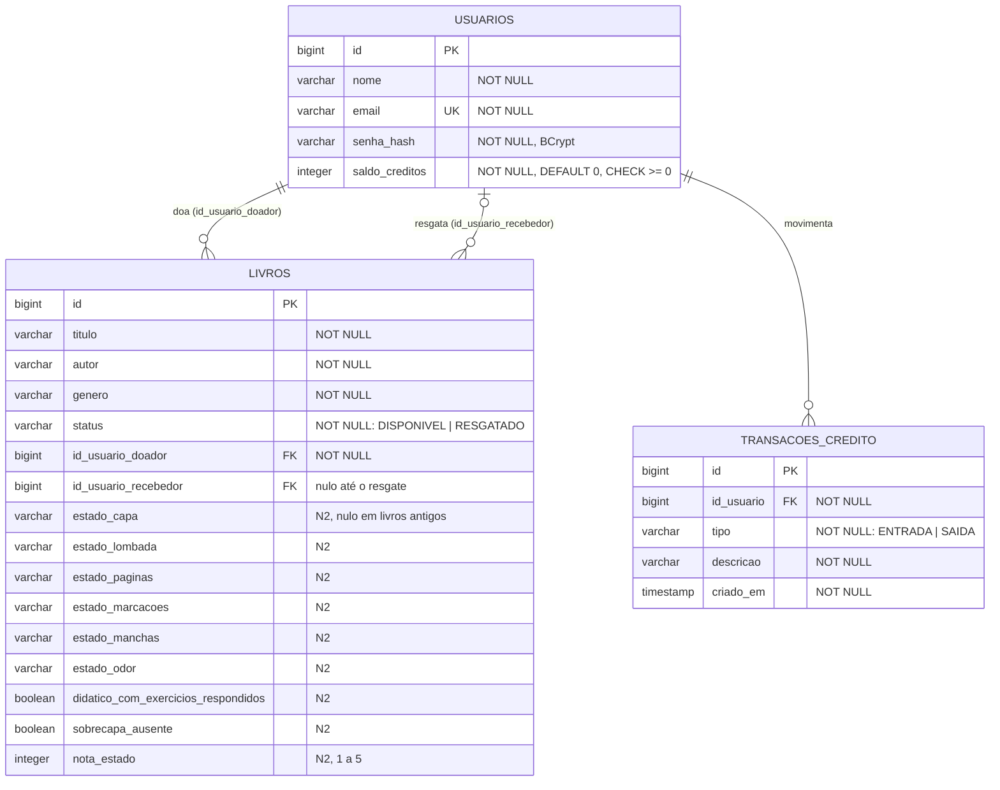

# DER — Modelo de dados do Vivlio

Estado na versão **v2.0 (N2)**. O schema é versionado pelo Flyway em
[`backend/src/main/resources/db/migration`](../../backend/src/main/resources/db/migration):

| Versão | Script | O que cria |
|---|---|---|
| V1 | `V1__schema_inicial.sql` | `usuarios`, `livros` e `transacoes_credito` (MVP, N1) |
| V2 | `V2__avaliacao_do_livro.sql` | Colunas da avaliação do estado do livro em `livros` (N2) |

Este diagrama é a fonte da verdade para a estrutura do banco. Qualquer mudança no schema entra por uma nova migração `V3__...sql`, nunca editando as anteriores, e este arquivo é atualizado no mesmo PR.

## Diagrama

## Tabelas

### `usuarios`

| Coluna | Tipo | Regra |
|---|---|---|
| `id` | `BIGINT` identity | PK |
| `nome` | `VARCHAR(255)` | obrigatório |
| `email` | `VARCHAR(255)` | obrigatório, **único** (`uk_usuarios_email`) |
| `senha_hash` | `VARCHAR(255)` | hash BCrypt, nunca a senha |
| `saldo_creditos` | `INTEGER` | começa em 0; `CHECK (saldo_creditos >= 0)` garante a RN crítica também no banco |

### `livros`

| Coluna | Tipo | Regra |
|---|---|---|
| `id` | `BIGINT` identity | PK |
| `titulo`, `autor`, `genero` | `VARCHAR(255)` | obrigatórios |
| `status` | `VARCHAR(255)` | `DISPONIVEL` ou `RESGATADO` (`ck_livros_status`) |
| `id_usuario_doador` | `BIGINT` | FK → `usuarios.id`, obrigatório |
| `id_usuario_recebedor` | `BIGINT` | FK → `usuarios.id`, preenchido no resgate |
| `estado_capa` … `estado_odor` | `VARCHAR(255)` | Código da opção escolhida em cada critério. Valores válidos nos enums de `avaliacao/entity/` |
| `didatico_com_exercicios_respondidos` | `BOOLEAN` | Limita a nota a 2 |
| `sobrecapa_ausente` | `BOOLEAN` | Só registro, não muda a nota |
| `nota_estado` | `INTEGER` | Menor nota entre os 6 critérios (1 a 5), calculada no servidor |

As colunas da N2 aceitam nulo porque os livros doados antes da avaliação não têm essas respostas. Elas ficam sem `CHECK` de propósito: incluir uma opção nova na ficha exige só mudar o enum Java.

### `transacoes_credito`

| Coluna | Tipo | Regra |
|---|---|---|
| `id` | `BIGINT` identity | PK |
| `id_usuario` | `BIGINT` | FK → `usuarios.id` |
| `tipo` | `VARCHAR(255)` | `ENTRADA` (doação) ou `SAIDA` (resgate) (`ck_transacoes_tipo`) |
| `descricao` | `VARCHAR(255)` | `Doação de livro` ou `Resgate de livro` |
| `criado_em` | `TIMESTAMP(6)` | Gravado no fuso do servidor; a API devolve com offset |

**Invariante:** `usuarios.saldo_creditos` = total de `ENTRADA` − total de `SAIDA` do usuário. Só o `CreditoService` altera o saldo, e o extrato (`GET /api/creditos/extrato`) expõe os dois lados. A invariante é coberta pelo `ExtratoControllerTest`, inclusive com resgates simultâneos.

## Divergências em relação à Especificação

| Especificação | Implementado | Motivo |
|---|---|---|
| Coluna `estado_conservacao` (Integer 1–5) | `nota_estado` + 6 colunas `estado_*` | A equipe trocou a escolha direta de estrelas pelo questionário da ficha de avaliação: o usuário descreve o livro e o sistema calcula a nota. O nome da coluna não foi alterado para não mexer no que já estava integrado. |
| "O usuário seleciona de 1 a 5 estrelas" | O usuário responde 6 perguntas; a nota é a menor | Mesma decisão. Precisa ser refletida na Especificação pela PO. |

`flyway_schema_history` é criada pelo próprio Flyway para registrar as versões aplicadas e não faz parte do modelo de domínio.
